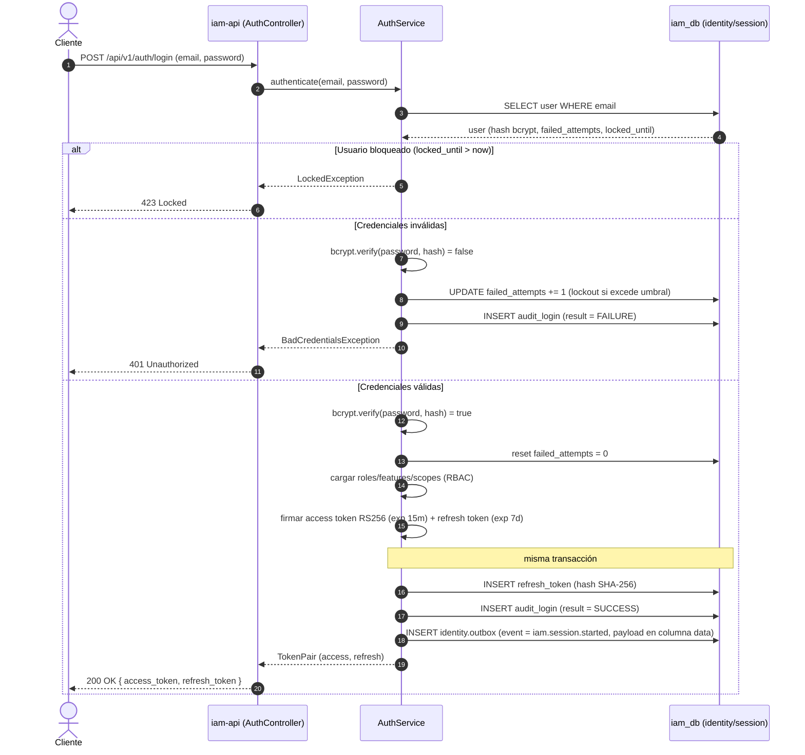

# Secuencia — Login + emisión de JWT (`iam-service`)

> Estado: 🟢 Listo | Última actualización: 2026-08-28
> Autor: Jesús Ariel González Bonilla (PM + Arquitecto) | Equipo: Arquitectura
> Alcance: flujo construido y probado en `develop` (Java / Spring). Fuente de comportamiento: [authentication.md](../../../07-api/authentication.md), [DEC-001](../../../09-microservices/services/01-iam-service/decisions.md) y [data-model del iam-service](../../../09-microservices/services/01-iam-service/data-model.md).

Flujo de autenticación por contraseña: validación de credenciales, verificación de bloqueo por
intentos fallidos (lockout), emisión del par de tokens JWT (RS256) y registro síncrono de la
auditoría de login más el *staging* del evento `iam.session.started` en el Outbox (misma
transacción). El JWT se firma con RS256; el `access token` vive 15 min y el `refresh token` 7 días.

## Notas

- El bloque `INSERT identity.outbox` deja el evento en *staging*; su publicación a `iam-events`
  la realiza el relay de forma asíncrona — ver [outbox-relay-events.md](./outbox-relay-events.md).
- El evento se persiste bajo la columna `data`; el relay lo renombra a `payload` al publicar.
- La clave pública de verificación RS256 se expone vía JWKS ([DEC-008](../../../09-microservices/services/01-iam-service/decisions.md)); los servicios downstream validan el token localmente sin llamar a iam.
- Cobertura de prueba: cubierto por las suites de `iam` (unit + ITs contra Postgres real: login, refresh, RBAC) y por el E2E de compose (login→JWT→endpoints→outbox→relay).
