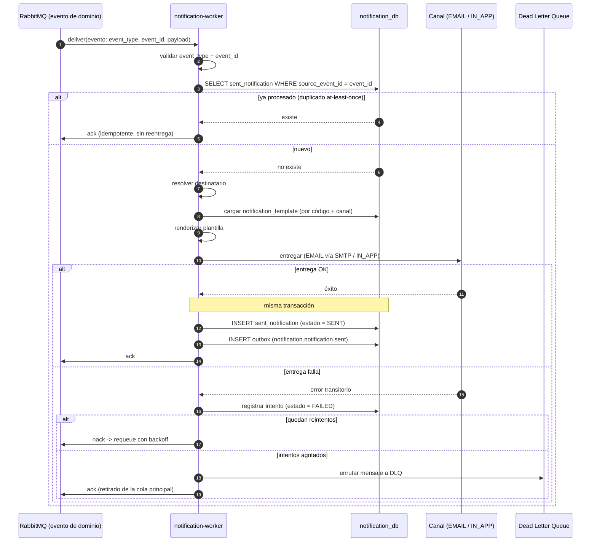

# Secuencia — Consumo de notificación: entrega / retry / DLQ (`notification-service`)

> Estado: 🟢 Listo | Última actualización: 2026-08-28
> Autor: Jesús Ariel González Bonilla (PM + Arquitecto) | Equipo: Arquitectura
> Alcance: flujo construido y probado en `develop` (Go). Fuente de comportamiento: [README del notification-service](../../../09-microservices/services/10-notification-service/README.md) y [decisions.md](../../../09-microservices/services/10-notification-service/decisions.md) (N06 idempotencia, N08 retry+DLQ).

`notification-worker` consume un evento de dominio desde RabbitMQ (AMQP), aplica idempotencia por
`event_id` / `source_event_id`, resuelve el destinatario, renderiza la plantilla y entrega por el
canal habilitado (`EMAIL` o `IN_APP`). Si la entrega finaliza en `SENT`, persiste
`sent_notification` y el registro Outbox en la misma transacción; si falla, reintenta con backoff
y enruta a la DLQ al agotar los intentos.

## Notas

- Idempotencia (N06): la protección por `source_event_id` sobrevive reinicios y concurrencia,
  porque RabbitMQ entrega *at-least-once*.
- Retry + DLQ (N08): backoff acotado; al agotar intentos el mensaje va a la DLQ para no bloquear
  la cola principal y separar fallos permanentes.
- El evento de salida `notification.notification.sent` se publica vía patrón Outbox (N07) cuando la
  entrega finaliza en `SENT`; lo consume `audit-service`.
- Cobertura: E2E vivo con broker/BD frescos — happy path, DLQ e idempotencia por `event_id`. Este
  camino es el que cazó el defecto HU-004 (use case devolvía `nil`) que las unitarias no detectaron.
