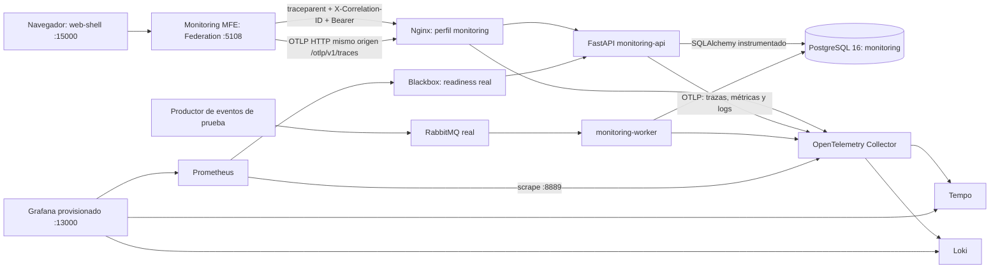

# Arquitectura implementada

> Estado: En revisión | Última actualización: 2026-10-20
> Autor: Kevin Andrey Culma Gómez | Equipo: Monitoring / ADSO 3145555

> Documento trasladado desde la entrega original. Las rutas de capturas y salidas se consultan en la carpeta local `EVIDENCIAS-PLAN-MEJORAMIENTO-R3`. Para el corte vigente, consultar el índice R3 y `estado-actual.md`; los resultados antiguos conservan su fecha y alcance.

El BFF local devuelve fixtures de Monitoring y queda fuera del recorrido R3. Nginx solo enruta: conserva los encabezados W3C y la correlación; no genera spans artificiales para aparentar instrumentación del proxy. No se valida aquí el login de IAM ni la emisión de eventos desde Academic, Scheduling o Actors. El perfil de pruebas usa una identidad RSA de ocho horas y un productor de eventos de entrada explícitamente identificado como prueba.

La petición del MFE inicia un span `CLIENT` con nombre de operación y ruta normalizada. El cliente inyectado por el shell conserva sus encabezados. FastAPI extrae el padre W3C, crea el span `SERVER`; dentro, el middleware registra la operación HTTP y el instrumentador SQLAlchemy crea spans al ejecutar consultas reales. La prueba `collect_r3_evidence.py` recorre los padres del INSERT hasta el span frontend y comprueba la fila directamente en PostgreSQL.

La correlación usa un identificador distinto del trace ID. Solo se aceptan 1–64 caracteres ASCII alfanuméricos, punto, guion o guion bajo; los demás valores se reemplazan por UUID. Un `ContextVar` se establece y se limpia en `finally`; acompaña logs internos, tareas del request y solicitudes concurrentes. El worker extrae contexto W3C de headers AMQP cuando exista y restaura su contexto tras procesar el mensaje.

En el colector se eliminan texto SQL, URLs completas y mensajes/stacktraces de eventos de excepción. Los spans conservan operación, duración, sistema de base de datos, ruta y resultado. El navegador nunca exporta cuerpos, tokens o query strings. Solo la clave pública del entorno local se monta en la API; claves privadas y tokens quedan ignorados por Git.
