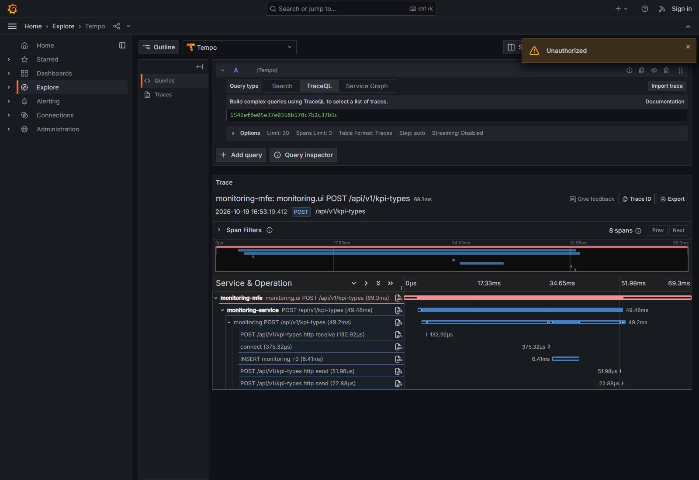
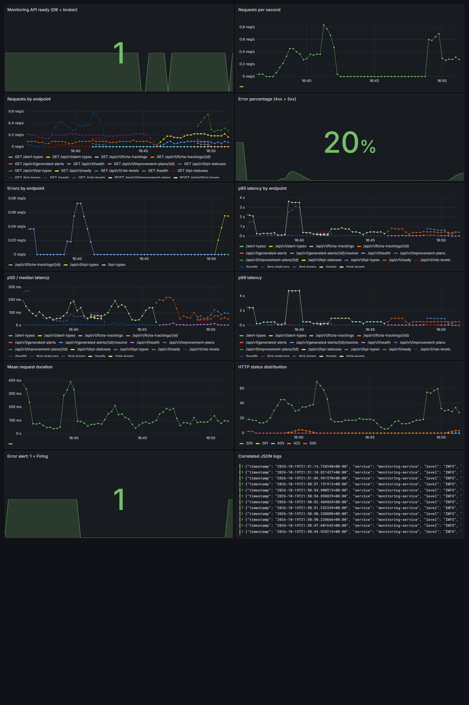

# Informe técnico breve — R3: observabilidad de Monitoring

> Estado: En revisión | Fecha de entrega: 2026-10-20
> Autor: Kevin Andrey Culma Gómez | ADSO 3145555
> PR propio: [#331](https://github.com/code-sena/design-software-docs/pull/331) | Rama: `fix/r3-observability`

## Contexto y decisión de diseño

Se implementó observabilidad sobre el recorrido real **Monitoring MFE → shell/proxy → FastAPI → PostgreSQL**. OpenTelemetry propaga `traceparent`, instrumenta HTTP y SQL, exporta métricas RED y permite correlacionar logs JSON mediante `trace_id`, `span_id` y un `correlation_id` independiente. El Collector envía trazas a Tempo, métricas a Prometheus y logs a Loki; Grafana reúne las señales en doce paneles.

El [ADR-010](../../../05-architecture/decisions/records/ADR-010-monitoring-r3-observability.md) justifica reutilizar OpenTelemetry y LGTM, instrumentar navegador/servidor/SQL y provisionar recursos declarativamente. Explica alternativas, seguridad, coste de instrumentación y reversión. Se normalizan las rutas para evitar cardinalidad por UUID y se eliminan detalles sensibles de las trazas. El modo de identidad R3 se restringe a desarrollo; el backend valida JWT RS256.

## Evidencias incluidas en este repositorio

Estas copias corresponden a ejecuciones locales del **19 de octubre de 2026**; publicar el informe el día 20 no constituye una nueva ejecución. Los originales completos permanecen en `EVIDENCIAS-PLAN-MEJORAMIENTO-R3`, junto a los repositorios. El [índice de evidencias](evidencias-informe/README.md) incluye procedencia y SHA-256.

**Traza completa.** La operación `POST /api/v1/kpi-types` produjo ocho spans con `trace_id=1541ef6e05e37e0356b570c7b2c37b5c`. El span CLIENT del MFE duró **69.3 ms** y el INSERT SQL **6.414150 ms**. El [JSON exportado](evidencias-informe/trace-summary.json) registra `parent_chain_verified=true`. Son observaciones de una solicitud, sin alcance de benchmark.



La captura original conserva un aviso `Unauthorized` de la interfaz de Grafana, además del árbol de spans cargado; no se retocó. La continuidad también queda documentada en el JSON exportado.

**Métricas y alerta.** Se miden tasa, errores HTTP y duración con histogramas para p50/p95/p99. La alerta cuenta 4xx/5xx, excluye health/readiness y exige **más del 5 % durante 20 s**, sobre una ventana de un minuto. Se provocaron respuestas 422 reales, sin endpoint artificial de fallo.

| Comprobación | Resultado observado | Evidencia |
|---|---|---|
| Prometheus durante el disparo, 16:50 de Bogotá | **14.148584 %** de errores; `firing` | [alert-firing.json](evidencias-informe/alert-firing.json) |
| Grafana durante el disparo | `firing`; el dashboard muestra aproximadamente 20 % en otra evaluación | Captura inferior y JSON anterior |
| Recuperación, 16:52 | Prometheus/Grafana `inactive`; alerta Grafana `Normal` | [alert-recovered.json](evidencias-informe/alert-recovered.json) |
| Colección posterior, 16:56, tras reducir el tráfico | 0 req/s y 0 % de errores en la ventana consultada | [Extracto de métricas y consultas](evidencias-informe/metricas-extracto.json) |



La captura y el JSON se tomaron en instantes diferentes; no se confunden sus porcentajes. Las rutas sin muestras pueden devolver `NaN` en percentiles: no se presentan como latencias medidas. El [log correlacionado](evidencias-informe/correlated-logs.json) conserva HTTP 201 y el mismo `trace_id` de la captura de Tempo.

**Salidas de prueba conservadas.** Se adjuntan las salidas originales, incluidas sus advertencias:

```text
Backend: 34 passed, 7 warnings in 24.62s
MFE:     Test Files 15 passed (15)
         Tests      65 passed (65)
```

Consultar [salida backend](evidencias-informe/domains-backend-tests.txt) y [salida MFE](evidencias-informe/mfe-tests-final.txt). La suite backend se ejecutó con PostgreSQL y RabbitMQ locales; las unitarias del MFE usan su entorno de prueba. Estas salidas no equivalen por sí solas a una prueba E2E de todos los dominios.

## Reproducción, resultado y límites

El [README](README.md#reproducción-local-desde-un-checkout-limpio) fija los repositorios y commits, incluidos `design-software-design-system` y `design-software-frontend-platform`, sus montajes Compose y los comandos de instalación y validación. El [informe ampliado](informe-tecnico.md) detalla scripts, integraciones y consultas.

La evidencia adjunta respalda trazas, métricas, logs y el ciclo real de alerta local. El IdP institucional sigue sin acceso; las HU externas y el cierre administrativo conservan el estado de la [matriz final](matriz-final.md). Los PR permanecen abiertos: falta revisión/fusión y repetición sobre las ramas integradas. Este informe no declara aprobación administrativa ni garantiza el veredicto de QA.
